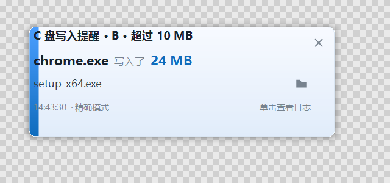
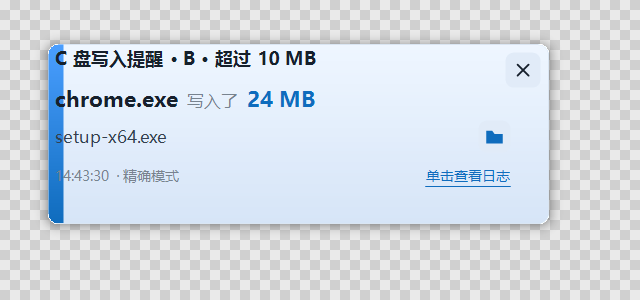
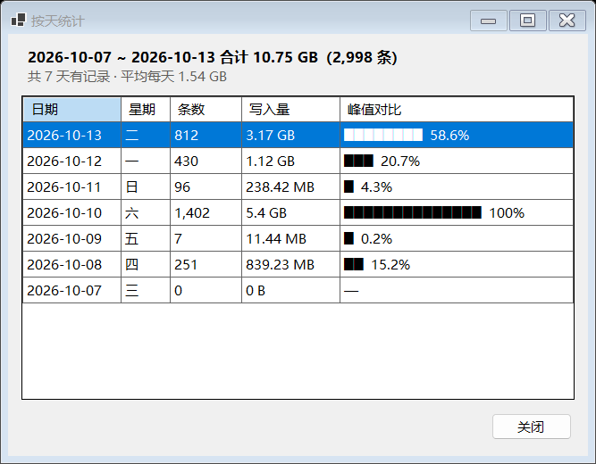

# CWriteWatcher · C 盘写入监控

[](https://github.com/erxiaowan/cMonitoring/actions/workflows/build.yml)


Windows 本地托盘小工具：监控 C 盘文件写入，按阈值提醒，**全程离线、不上传任何数据**。

- 平台：Windows 10 / 11 x64
- 运行时：.NET 8（WinForms 托盘程序）
- 形态：系统托盘常驻，无主窗口

---

## 一分钟上手

```bash
# 1. 编译
dotnet build CWriteWatcher.sln -c Release

# 2. 运行（标准模式，免管理员）
dotnet run --project src/CWriteWatcher.App

# 3. 或发布为免安装单文件 exe
dotnet publish src/CWriteWatcher.App -c Release -r win-x64 --self-contained true `
  -p:PublishSingleFile=true -p:IncludeNativeLibrariesForSelfExtract=true `
  -o publish/self-contained
```

程序启动后直接进托盘（不弹窗口），双击托盘图标打开设置。

> **精确模式需要管理员权限。** 在设置 → 常规里切换到精确模式时，程序会询问是否以管理员身份重启。

---

## 核心设计：为什么是双模式

这是整个项目最重要的一条约束，先说清楚：

> **用户态没有「免管理员 + 精确单次写入字节数」的方案。**

Windows 用户态能拿到文件变更的公开接口只有 `ReadDirectoryChangesW` 和 USN Journal，
它们返回的都是"某个文件被改了"，**没有长度字段、没有偏移量、没有发起进程**。
真正的"某进程在偏移 X 处写入 Y 字节"只存在于文件系统驱动栈的 `IRP_MJ_WRITE` 里，
用户态唯一的正规读取渠道是 ETW 的 `Microsoft-Windows-Kernel-File` —— 而它**需要管理员**。

所以工具做成两个模式：

| | 标准模式（默认） | 精确模式 |
|---|---|---|
| 采集方式 | `ReadDirectoryChangesW` | ETW `Kernel-File` 实时会话 |
| 权限 | **普通用户** | **管理员** |
| 写入字节数 | 差分**估算** | **精确** |
| 发起进程 | 拿不到 | **精确** |
| 全盘覆盖 | 句柄爆炸，需谨慎 | 单会话覆盖，开销低 |
| 原地覆盖写 | **漏报** | 能检测 |

UI 上严格区分两种数值：估算值显示为 `≈ 12.4 MB`，精确值显示为 `12.4 MB`。

---

## 项目结构

```
CWriteWatcher.sln
Directory.Build.props
src/
  CWriteWatcher.Core/            # 领域模型 + 处理管道（不依赖 UI）
    Models/
      Enums.cs                   # CollectorMode / TriggerMode / ThresholdScope / WriteKind / GovernanceLevel
      FileWriteEvent.cs          # 两种采集模式归一化后的统一事件结构
      AlertRecord.cs             # 提醒记录 + SuppressReason
    Config/
      AppConfig.cs               # 全部配置项（含默认排除表播种）
      ConfigStore.cs             # 原子写入 + 变更通知
    Filtering/
      DefaultExclusions.cs       # 内置排除表（系统/Defender/索引/浏览器/同步盘/自身）
      ExclusionMatcher.cs        # 零分配快路径匹配（目录前缀 → 精确 → 扩展名 → 通配）
    Pipeline/
      EventPipeline.cs           # 有界 Channel + 单消费者，全部闸门按序执行
      ThresholdEvaluator.cs      # P1 / P2 / P3 三种阈值口径 + 固定窗口
      OffsetCoalescer.cs         # ★ Offset 连续性归并
      RateLimiter.cs             # 三层节流（文件 / 进程 / 全局令牌桶）
      QuietHours.cs              # 静默时段（支持跨零点）
      LoadGovernor.cs            # ★ 四级降级 + 自动恢复
      AlertAggregator.cs         # 同进程短时间内的多条提醒合并
      PipelineStats.cs           # 无锁计数器 + 快照
    Collectors/
      IFileWriteCollector.cs     # 采集器接口 + CollectorStats
      NativeMethods.cs           # RDCW 相关 Win32 声明
      DirectoryWatcherCollector.cs  # 标准模式实现
    Logging/
      EventLogStore.cs           # SQLite 批量写入 + 环形裁剪 + CSV/JSON 导出
      LogQuery.cs
    Diagnostics/
      CpuSampler.cs              # CPU（占整机口径）与内存采样
    Util/
      PathUtil.cs                # 路径规范化 / 设备路径转换 / 稳定哈希

  CWriteWatcher.Etw/             # 精确模式（可独立于 App 编译测试）
    Native/EtwNative.cs          # ETW + TDH P/Invoke 与结构体
    Parsing/EventSchemaCache.cs  # ★ 运行时 TDH schema 发现 + payload 顺序遍历
    Parsing/FileKeyPathMap.cs    # ★ FileKey → 路径 映射（TTL + LRU + 排除即释放）
    Parsing/KernelFileEventRouter.cs  # ★ 纯函数：事件 ID → 动作 + 用哪个键（可单测）
    Parsing/ProcessNameCache.cs  # PID → 进程名（带 TTL）
    EtwKernelFileCollector.cs    # 会话管理 + 事件分发

  CWriteWatcher.App/             # WinForms 托盘程序
    Program.cs
    TrayApplicationContext.cs    # 托盘菜单 / 暂停 / 自启 / 诊断导出
    app.manifest                 # longPathAware + PerMonitorV2 DPI + asInvoker
    Services/
      WatcherHost.cs             # 总装配：配置 + 采集器 + 管道 + 日志 + 定时器
      AutoStartManager.cs        # ★ 先删后写的自启管理
      SingleInstanceGuard.cs     # Local\ Mutex + 唤起事件
      NotificationService.cs     # 自绘置顶窗 + Toast + 托盘气泡 + 声音
      IconFactory.cs             # 运行时绘制图标
    Forms/
      SettingsForm.cs            # 7 个标签页的设置界面
      LogForm.cs                 # 日志查看 / 筛选 / 导出
      AlertPopup.cs              # ★ 自绘置顶提醒窗（绕开 Windows 通知平台）
      Ui.cs                      # 控件工厂（按钮高度随 DPI 自适应）

tests/
  CWriteWatcher.Tests/           # 149 个单元 + 集成测试（Core / Etw）
  CWriteWatcher.UiSmoke/         # 11 个界面布局冒烟测试（真实窗体 + 真实 DPI）
docs/
  01-设计评审-C盘写入监控工具.md  # v0.1 方案选型（已被 v0.2 取代）
  02-设计评审-v0.2.md            # 当前有效设计
  03-安装与运行说明.md
  04-测试用例.md
  05-已知限制.md
```

---

## 四个关键技术点

### 1. Offset 连续性归并（`OffsetCoalescer`）

NTFS 会把一次 100 MB 的 `WriteFile` 拆成几十到上百个 IRP。**如果按"单个 IRP ≥ 10 MB"判定，这个文件保存一次都不会触发** —— 用户会认为工具完全没用。

`Write` 事件带 `Offset`。归并条件：

```
相同 FileKey + 相同 IssuingThreadId
且 Offset_{n+1} == Offset_n + Size_n
且两次事件间隔 < 200 ms
```

满足则把碎片合并为**一次逻辑写入**，这才是用户心里的"单次写入"。
不满足时退化为 1 秒固定窗口累计。

> 必须按 `IssuingThreadId` 分组：多线程并发写同一文件时 Offset 会交错，不分组会导致归并链断裂。

### 2. FileKey → 路径 映射（`FileKeyPathMap`）

ETW 的 `Write` 事件只带 `FileKey` / `FileObject`，不带路径。没有路径就无法做排除过滤，也无法在通知里显示文件。

**映射表有两条来源、两个键空间**（Kernel-File 的字段分布很不一致，这是最容易踩的坑）：

| 事件 | 提供的字段 | 用途 |
|---|---|---|
| `NameCreate(10)` | `FileKey` + `FileName` | 建 `FileKey → 路径` |
| `Create(12)` | `FileObject` + `FileName`，**没有 `FileKey`** | 建 `FileObject → 路径` |
| `Write(16)` | `FileObject` + `FileKey` **都有** | 查询时两个键都试 |
| `CreateNewFile(30)` | 新建文件的权威信号 | 模式 A「仅提醒新建文件」 |

> ⚠️ **`Create(12)` 事件里没有 `FileKey`。** 用 `FileKey` 当键会让映射表**永远是空的**，
> 精确模式下所有写入都变成"未知路径"被丢弃 —— 且没有任何报错。详见
> [`docs/04-测试用例.md` 缺陷 9](docs/04-测试用例.md#缺陷-9create-事件里没有-filekey代码却拿它当映射表的键--精确模式40-万次写入零提醒)。

- `Cleanup(13)` / `Close(14)` → 移除 `FileObject` 映射（内核对象地址会被快速回收）；
  **不移除 `FileKey`**（同一文件可能还有别的句柄在用）
- `NameDelete(11)` / `DeletePath(26)` → 移除 `FileKey` 映射
- **但 `Close` 不保证到达**（强杀进程 / 关机 / 驱动持有句柄）→ 必须有 TTL 5 分钟 + LRU 20 万条
- **排除路径立即释放字符串**：判定为排除后把 Path 置空只留标记，把映射表内存从 ~32 MB 压到 < 2 MB
- 映射缺失 → 显示"未知路径"，**计入统计但不弹窗**（避免噪音）

**分发逻辑独立成纯函数** `KernelFileEventRouter.Route(eventId, fields)`，不碰 ETW 状态，因此可以被单元测试覆盖（42 个用例）。

**已知缺口**：程序启动**之前**就已打开的长期句柄（数据库、日志、正在下载的大文件）永远不会有 `Create` / `NameCreate` 事件，会永久显示"未知路径"。不采用"启动时全盘枚举建立初始映射"的做法——几十万文件需要数秒到数分钟。

### 3. ETW schema 运行时发现（`EventSchemaCache`）

`Microsoft-Windows-Kernel-File` 的 manifest 会随 Windows 版本微调，**硬编码字段偏移一旦对不上就会静默解析出垃圾数据**。

这里改为运行时通过 TDH 的 `TdhGetEventInformation` 查询真实 manifest，首次遇到某个 Event ID 时构建 schema 并缓存，之后按 schema 顺序遍历 payload（ETW manifest payload 是紧凑排布、无对齐填充的）。

不用 `TdhGetProperty` 逐字段读的原因：它每次都要重新解析事件，单次成本在微秒级，每秒数万事件下会直接吃掉 CPU 预算。

托盘菜单的 **「导出 ETW 诊断信息」** 会把已发现的事件 schema 全部 dump 出来，是排查精确模式问题的第一手段。

### 4. 四级降级 + 自动恢复（`LoadGovernor`）

| 级别 | 触发条件 | 行为 |
|---|---|---|
| L0 正常 | CPU < 2% | 全功能 |
| L1 轻载 | 2% ≤ CPU < 10% 持续 5s | 扩大聚合窗口 |
| L2 重载 | CPU ≥ 10% 持续 10s | 暂停模式 A，只保留阈值触发 |
| L3 风暴 | 队列积压 > 80% | `DropOldest` 丢弃 |

**关键：必须有恢复机制。** CPU < 2% 持续 30 秒 → L3→L2→L1→L0 逐级恢复。
没有恢复的话，一次 Windows Update 全盘扫描就会让工具**永久停在 L2**，之后所有普通写入都不再提醒，而用户完全察觉不到。

降级必须留痕：设置页状态标签会显示"已降级至 L2 · 已丢弃 N 条事件"以及具体原因。

---

## 提醒通道

一条提醒会**同时**走所有已启用的通道（设置 → 提醒 里可逐项开关）：

| 通道 | 默认 | 走 Windows 通知平台？ | 说明 |
|---|---|---|---|
| **自绘置顶提示窗** | ✅ | **否** | 右下角 Fluent 卡片（蓝色渐变）；不抢焦点、不占任务栏、不进 Alt-Tab |
| Windows Toast | ✅ | 是 | `Microsoft.Toolkit.Uwp.Notifications` |
| 托盘气泡 | ✅ | 是 | `NotifyIcon.ShowBalloonTip` |
| 声音提示 | ❌ | **否** | `SystemSounds.Exclamation` |
| 托盘图标变红 4 秒 | 固定 | **否** | 最后提示，一定可见 |

> ⚠️ **Toast 和托盘气泡走的是同一条 Windows 通知管道。**
> Win10/11 上 `ShowBalloonTip` 也是由外壳渲染成 Toast 的 ——
> 只要系统「通知总开关」（`HKCU\...\PushNotifications\ToastEnabled`）为 `0`，
> 或「专注助手」生效，**两条会一起失效，而且 API 完全不报错**。
>
> 这正是「自绘置顶窗」存在的原因：它是程序自己画的顶层窗口，**任何系统设置都挡不住**。
>
> 排查方法：设置 → 提醒 → **「发送测试提醒」**，按钮下方会直接显示
> `置顶窗 ✓ / Toast ✗ / 气泡 ✗ / 声音 ✗` 以及降级原因。
> 详见 [`docs/05-已知限制.md` §4.5](docs/05-已知限制.md)。

### 自绘置顶提示窗长什么样

```
╭──────────────────────────────────────────────╮
│▌ C 盘写入提醒 · 超过 10 MB               ×   │
│                                              │
│  chrome.exe  写入了  24 MB                   │
│                                              │
│  setup-x64.exe                        📂     │
│                                              │
│  10:14:44 · 精确模式        单击查看日志      │
╰──────────────────────────────────────────────╯
```

- **视觉**：圆角 8px、柔和投影（下沉偏移）、**蓝色渐变**（卡片底 `#F7FAFF → #E1ECFA`，左侧强调条 `#4A9EFF → #0F6CBD`）。

  | 默认 | 悬停 |
  |---|---|
  |  |  |

- **层级**：标题加粗；程序名与大小最大最重（大小用 `#0F6CBD` 强调蓝）；底部信息小字灰色。
- **长路径**：主行**只显示文件名**（单行 + 省略号截断），完整路径悬停显示；
  右侧 📂 按钮直接在资源管理器里定位该文件。**任何情况下都不会撑破布局。**
- **交互**：
  | 操作 | 效果 |
  |---|---|
  | 悬停卡片 | 背景微暗、光标变手型、倒计时暂停 |
  | 悬停 × | 淡灰圆角背景、图标变深 |
  | 悬停 📂 | 淡灰圆角背景、图标变蓝 |
  | 悬停「单击查看日志」 | 变蓝 + 下划线 |
  | 单击卡片任意处 | 打开日志窗口 |
  | 单击 📂 | 在资源管理器中定位文件 |
  | 单击 × | 关闭 |

> 图标是 **GDI+ 矢量绘制**（WinForms 没有 SVG 运行时，为两个图标引第三方库不划算）——
> 效果等价：分辨率无关、任意 DPI 下都锐利，且不依赖外部资源文件。
>
> **文字也是 GDI+ 管线**（`MeasureString` / `DrawString`），且**测量与绘制必须同引擎**。
> 这一点踩过坑：卡片为了做到「外侧全透明」用了分层窗口（`UpdateLayeredWindow`），
> 而 **GDI 的 `TextRenderer` 在带 alpha 通道的位图上，ClearType 会退化成无抗锯齿**
> —— 文字变成又粗又硬的块状。改用 GDI+ 后才恢复清晰。详见
> [`docs/04-测试用例.md` 缺陷 16](docs/04-测试用例.md)。

---

## 我到底往 C 盘写了多少（聚合与趋势）

逐条事件日志回答不了「今天/本周一共写了多少」—— 而这恰恰是关心 SSD 寿命的人最想知道的。

**日志窗口底部**直接显示当前筛选范围的合计：

```
2026-10-13 合计 ≈ 12.4 GB（1,234 条） · 本页 100 条 · 数据库共 5,000 条 · ...
```

配合「今天 / 昨天 / 最近 7 天 / 全部时间」快捷按钮，切换范围就等于看趋势。

**「按天统计」按钮**打开趋势窗口，按**本地日期**汇总：

| 日期 | 星期 | 条数 | 写入量 | 峰值对比 |
|---|---|---|---|---|
| 2026-10-13 | 二 | 812 | 3.17 GB | 58.6% |
| 2026-10-10 | 六 | 1,402 | 5.4 GB | 100% |
| 2026-10-07 | 三 | 0 | 0 B | — |



几个刻意的设计：

- **合计带精度前缀**：范围内只要混有一条估算值（标准模式产生的），合计就只能标 `≈`。
  把估算值当精确值报给用户，比不给数字更糟。
- **按本地日期分组**，不是 UTC —— 否则东八区晚上 8 点之后的写入会被算到第二天。
- **条长与百分比同口径**（都相对峰值）。一个「条长相对峰值、数字相对合计」的列会让用户对不上。
- **零字节显示 `—`**，不画格子 —— 给 0 画一格会让人以为「有一点写入」。
- 聚合查询与分页查询**共用同一个 WHERE 构造器**，保证「列表条数」和「合计」永远对得上。

---

## 事件丢失会如实告诉你

**两种模式下的事件丢失都会被计数并显示出来**，不会静默少记：

| 模式 | 丢失来源 | 语义 |
|---|---|---|
| 标准模式 | `ReadDirectoryChangesW` 缓冲区溢出 | 溢出**次数**（每次丢一批，条数不可知） |
| 精确模式 | ETW 缓冲区不足 | 丢失**条数**（ETW 精确报告） |

显示在三处：设置 → 状态 → **运行统计**里的「丢失事件」一行（带人话解释）、
托盘提示（有丢失时附加 `· 丢 N`）、诊断信息导出。

> 精确模式每 30 秒用 `ControlTrace(QUERY)` 拉一次 `EventsLost` / `RealTimeBuffersLost` ——
> 这两个计数器只存在于 `EVENT_TRACE_PROPERTIES` 里，QUERY 是唯一读取途径。
> 详见 [`docs/04-测试用例.md` 缺陷 17](docs/04-测试用例.md)。

---

## 防通知风暴

三层节流，依次生效：

| 层级 | 默认值 | 作用 |
|---|---|---|
| 文件级 | 同路径 60 秒 | 防止同一文件反复刷屏 |
| 进程级 | 同进程 30 秒 | 防止某进程批量写触发风暴 |
| 全局令牌桶 | 1 条 / 2 秒，突发 5 条 | 最后的保险丝 |

被任何一层拦下的事件**仍会记入日志**，只是不弹提醒。

再加上默认排除表（系统核心 / Defender / 索引 / Windows Update / 浏览器缓存 / 同步盘 / Toast 通知历史 / 自身进程），以及：
- **标准模式**在枚举阶段就跳过命中排除表的目录子树（WinSxS、SoftwareDistribution、Packages 等），可省下数千个句柄
- **精确模式**在 ETW 回调里就丢弃被排除的事件，避免它们进入 Channel

---

## 配置与数据位置

```
%AppData%\CWriteWatcher\
  config.json          # 配置（原子写入，损坏时自动备份为 config.json.corrupt-<时间戳>）
  events.db            # SQLite 日志（WAL 模式）
  events.db-wal
  events.db-shm
  diagnostics-*.txt    # 手动导出的诊断信息
```

日志默认保留 10 万条 / 200 MB，超出按最旧优先裁剪。

---

## 常用操作

| 操作 | 位置 |
|---|---|
| 打开设置 | 双击托盘图标 / 右键 → 打开设置 |
| 暂停监控 | 右键 → 暂停监控 → 15 / 30 / 60 分钟 / 直到手动恢复 |
| 查看日志 | 右键 → 查看日志（支持时间/进程/路径/大小筛选、分页、CSV/JSON 导出） |
| 按日期查日志 | 日志窗口 → 日期用日历下拉选到「天」（默认查今天）；快捷按钮 **今天 / 昨天 / 最近 7 天 / 全部时间** |
| 发送测试提醒 | 设置 → 提醒 → 「发送测试提醒」（走真实通道，直接显示各通道成功/失败） |
| 导出诊断 | 右键 → 导出 ETW 诊断信息 |
| 开机自启 | 右键 → 开机自动启动（或设置 → 常规） |
| 退出 | 右键 → 退出 |

---

## 测试

```bash
# 单元 + 集成测试（Core / Etw）
dotnet test tests/CWriteWatcher.Tests

# 界面布局冒烟测试（构造真实窗体，需要桌面会话）
dotnet test tests/CWriteWatcher.UiSmoke
```

**149 个单元/集成测试**覆盖：排除表匹配、阈值三种口径、Offset 归并、三层节流、静默时段跨零点、FileKey 映射生命周期、提醒聚合、路径规范化、端到端管道闸门顺序、**ETW 结构体尺寸与偏移**、**Kernel-File 事件分发（用哪个键建映射）**，以及**标准模式采集器在真实文件系统上的集成测试**。

**11 个界面冒烟测试**在真实 DPI 下构造真实窗体（设置 / 日志 / 自绘提示窗），检查：按钮高度是否放得下文字、说明标签是否为空、控件是否被父容器裁掉、日期筛选是否只到「天」且默认查今天。

> **这两类测试都不是可选项。** 项目曾有 9 个缺陷满足「编译通过 + 单元测试全绿 + 运行时明显坏掉」：
> 采集器的 `NativeOverlapped` 复用导致**一启动就崩溃**、`GetFileAttributesExW` 漏 `CharSet` 导致**零事件**、
> 按钮高度不足导致**中文被纵向裁切**、`Hint()/Warn()` 漏赋值导致**整个界面的提示文字全部不可见**、
> 聚合器在 `Size` 全为 0 时**丢失文件路径**、
> ETW 的 `WNODE_HEADER` 多一个字段导致**精确模式 `StartTrace` 返回 161**、
> `EVENT_TRACE_LOGFILE.LogfileHeader` 被声明成指针导致**提权后访问冲突崩溃**、
> `EVENT_PROPERTY_INFO` 少 3 个 union + 按事件名判定导致**261 万事件零接收**、
> `Create` 事件里没有 `FileKey` 却拿它当映射表的键导致**精确模式 40 万次写入零提醒**。
> 详见 [`docs/04-测试用例.md`](docs/04-测试用例.md#六回归用例已修复缺陷)。

详见 [`docs/04-测试用例.md`](docs/04-测试用例.md)。

---

## 文档

- [设计评审 v0.2](docs/02-设计评审-v0.2.md) — 当前有效的设计决策
- [安装与运行说明](docs/03-安装与运行说明.md)
- [测试用例](docs/04-测试用例.md)
- [已知限制](docs/05-已知限制.md) ← **使用前请务必阅读**
- [同类项目对比与改进](docs/06-同类项目对比与改进.md) — 与 GitHub 同方向项目的对照、已做的改进、明确不做的事

---

## 隐私与安全

### 数据不会离开本机

- **代码里没有任何网络 API**（`HttpClient` / `WebClient` / `Socket` / `Dns` … 一个都没有），
  也没有遥测、更新检查或崩溃上报。可以用 `grep -rniE "HttpClient|Socket|WebRequest" src/` 自行核实。
- 全部数据只落在 `%AppData%\CWriteWatcher\`：
  | 文件 | 内容 |
  |---|---|
  | `config.json` | 设置 |
  | `events.db` | 提醒日志（SQLite） |
  | `run.log` | 运行痕迹（启动/退出/异常） |
  | `diagnostics-*.txt` | 手动导出的诊断信息 |

- 该目录的 ACL 只有 **SYSTEM / Administrators / 当前用户**，
  **同机其他用户读不到**（可用 `icacls %AppData%\CWriteWatcher` 核实）。
- 程序不创建任何临时文件。

### 需要注意的两点

1. **日志与导出文件含完整文件路径**（这是工具的功能本身）。
   把 `events.db` 或导出的 CSV/JSON 分享给别人，等于分享你的目录结构与进程清单 —— 分享前留意。
2. **建议安装到 `%ProgramFiles%`**。
   「精确模式 + 开机自启」会创建一个 `/RL HIGHEST` 的计划任务指向程序自身；
   如果程序放在**当前用户可写**的目录里，同用户的低权限进程可以替换 exe，
   从而在下次登录时获得一次静默提权执行。放到 `%ProgramFiles%` 可消除这条路径。
   详见 [`docs/05-已知限制.md` §7.8](docs/05-已知限制.md)。

### 已做的防护

- SQL 全部参数化（无注入面）。
- 导出的 CSV 对 `= + - @` 开头的字段做**公式注入中和**（进程名是攻击者可控制的）。
- 交给外壳打开的路径做**命令行注入与 UNC 校验**（UNC 会触发 SMB 连接）。
- 日志表格双击打开文件前校验路径合法性。
- 排除规则的通配符转正则做了**回溯防护**（折叠连续 `*` + 50ms 匹配超时 + 超时熔断），
  并限制规则条数与单条模式长度。

### 依赖漏洞审计

用 `dotnet list package --vulnerable --include-transitive` 审计，**当前 5 个项目全部零告警**。
审计过程中处置过两条，记录在此以便复查：

| 包 | 严重性 | 判定 | 处置 |
|---|---|---|---|
| `SQLitePCLRaw.lib.e_sqlite3` | High（CVE-2025-6965） | **版本确实受影响**（捆绑 SQLite 3.41.2 < 3.50.2） | 显式提升到 **3.53.3** |
| `System.Drawing.Common` 4.7.0 | Critical（CVE-2021-24112） | **双重不适用** | 显式提升到 8.0.0 |

> **为什么 SQLite 要显式提升**：`Microsoft.Data.Sqlite`（含最新的 10.0.6）传递依赖的
> `SQLitePCLRaw.bundle_e_sqlite3` 最高只到 2.1.11，官方链路里没有修好的版本。
> 但 `SQLitePCLRaw.lib.e_sqlite3` 是**纯原生 DLL 包**（零托管代码），
> 显式引用 3.53.3 即可把捆绑的 SQLite 换掉，**不改变任何托管 API**。
>
> **为什么 `System.Drawing.Common` 是误报**：① 该 CVE 公告原文写明「只存在于 macOS / Linux」，
> 本项目是 Windows 专用；② 4.7.0 的程序集**根本没随程序发布** ——
> `net8.0-windows` + `UseWindowsForms` 下运行时用的是 .NET 8 框架自带的版本。

> **待办**：`Microsoft.Toolkit.Uwp.Notifications 7.1.3` 已是该包的**最后一版**，无人维护。
> 本身无已知 CVE，但不会再收到安全修复；继任者是 `CommunityToolkit.WinUI.Notifications`。

---

## 构建与测试

```bash
git clone https://github.com/erxiaowan/cMonitoring.git
cd cMonitoring
dotnet build CWriteWatcher.sln -c Release
dotnet test  CWriteWatcher.sln -c Release
```

发布成免安装单文件（朋友双击即用，不需要装 .NET）：

```bash
dotnet publish src/CWriteWatcher.App -c Release -r win-x64 --self-contained true \
  -p:PublishSingleFile=true -p:IncludeNativeLibrariesForSelfExtract=true \
  -o publish/self-contained
```

> 界面冒烟测试需要桌面会话；在没有交互式桌面的环境（CI）里会自动跳过，不会误报失败。

## 贡献

欢迎提 issue 和 PR。提交前请确保：

- `dotnet build -c Release -warnaserror` 通过（本项目长期保持 0 警告）
- `dotnet test -c Release` 全绿
- 修缺陷时**附一个能红的回归用例** —— 这个项目的每个已修缺陷都有对应的测试，
  见 [`docs/04-测试用例.md` §六](docs/04-测试用例.md)

安全相关问题请走 [`SECURITY.md`](SECURITY.md)，**不要开公开 issue**。

## 许可证

[MIT](LICENSE)
